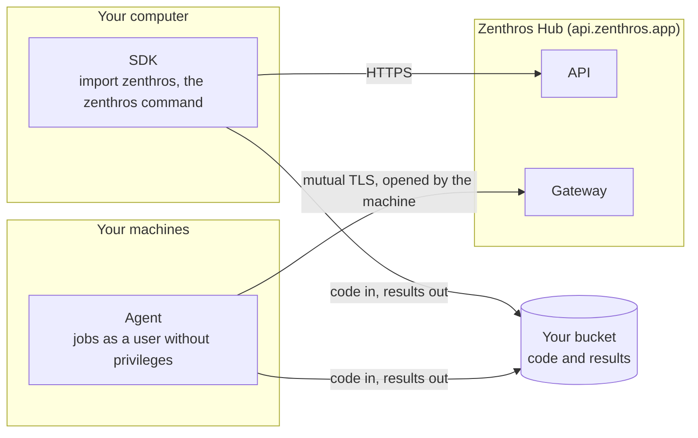

# Zenthros: the agent and the SDK

Zenthros runs your Python code on machines of yours, from a notebook or a
script: this computer, another computer you attach, a VM in a cloud account of
yours, or a GPU pod. This repository holds the parts that run on your side,
open source under the Apache License 2.0. The part in the middle, Zenthros
Hub, is a hosted service ([zenthros.app](https://zenthros.app)) and its code
is not here.

## How it fits together



**The SDK** (`sdk/python`) is what you use: `@zenthros.cloud`, `.remote()`,
`zenthros run`, `zenthros attach`. With no account it runs jobs on this
computer, in a container that holds the same agent, and talks to no hub.
Logged in to a hub, it asks the hub's API to run a job on one of your machines.
A coding agent uses it too: `zenthros mcp` serves it six tools over MCP
(`targets`, `spend`, `run`, `status`, `logs`, `cancel`), and `zenthros agent
skill` writes the skill that tells it when to use them and how to read a result.

**Zenthros Hub** coordinates. It keeps your account and Workspace, the name
and hardware of your machines and the record of each job. It decides which
machine runs each job, joins a machine with a single-use token, and, in a
cloud account you register, creates and stops the machines a pool asks for.
Your code, data and results go to your bucket, not to the hub. A job's log is
read from its machine when you ask for it: it passes through the hub and is
not kept there.

**The agent** (`operator/cmd/agent`) runs on each machine you attach. It opens
the connection to the hub's gateway itself, with mutual TLS: the machine opens
no port and the hub never logs in to it. It runs each Workspace's jobs as a
user of their own, without privileges: as systemd units or containerd
containers on a VM, inside a container (a GPU pod, this computer), or as pods
in a Kubernetes cluster you attach.

**zenadm** (`operator/cmd/zenadm`) joins a machine. The key is made on the
machine, and the single-use token of `zenthros attach` gets it a certificate
the hub signs; then the agent starts with it.

## What is in this repository

| Path | What it is |
| ---- | ---------- |
| `sdk/python` | The `zenthros` Python package and command ([its README](sdk/python/README.md)) |
| `sdk/python/zenthros/mcp.py` | `zenthros mcp`, the MCP server for a coding agent, on stdin and stdout |
| `sdk/python/zenthros/_data/skill` | The skill a coding agent reads ([SKILL.md](sdk/python/zenthros/_data/skill/SKILL.md) and its references), which `zenthros agent skill` writes |
| `operator/cmd/agent` | The agent |
| `operator/cmd/zenadm` | What joins a machine to a hub |
| `operator/cmd/unzstd` | `zenthros-unzstd`, which unpacks a release's `.zst` files: a machine needs neither zstd nor root to install |
| `operator/internal/grpc/proto` | The protocol between the agent and the hub's gateway |
| `operator/pkg/api/testdata/wire` | The hub API's routes and refusals, which the SDK's tests hold it to |
| `operator/scripts/install-agent.sh`, `install/` | The installers, and how a release is built |
| `k3s/helm/zenthros-agent` | The agent's chart, for a Kubernetes cluster you attach |

`operator/` is the Go module of the agent's side: only the packages the agent,
zenadm and the unpacker build are here.

## Versions

A release holds the SDK's wheel and the agent, zenadm and chart of the same
tag. The SDK and the hub also check a format number of their own: a hub
answers an SDK of another format with what to install (HTTP 426), and an
agent of another protocol with "run the attach line again".

## Start

The SDK is not on PyPI: each release has its wheel.

```bash
pip install "zenthros[seal] @ https://github.com/takenking9879/zenthros-oss/releases/download/v0.1.0/zenthros-0.1.0-py3-none-any.whl"
zenthros --version
```

Then [the SDK's README](sdk/python/README.md): a first job on this computer
with no account, then a hub and your machines. For a coding agent:

```bash
claude mcp add zenthros -- zenthros mcp
zenthros agent skill                            # .claude/skills/zenthros
zenthros agent allow my-pool --max-machines 3   # what costs money needs your word
```

## Build and test

```bash
cd operator && go build ./cmd/agent ./cmd/zenadm ./cmd/unzstd && go test ./...
make -C sdk/python env test lint
```

The Go version is the `toolchain` line of `operator/go.mod`; the SDK's
environment is `sdk/python/.venv`, made with uv by `make env`.

## Check that a release is this code

The agent runs as root on your machine, so you can check that the one you
downloaded comes from this code. `.github/workflows/release.yml` builds each
release from its tag. Build the same binary and compare:

```bash
git checkout v0.1.0
cd operator
CGO_ENABLED=0 GOOS=linux GOARCH=amd64 go build -trimpath -buildvcs=false \
  -ldflags="-s -w -X github.com/takenking9879/zenthros-oss/operator/internal/buildinfo.Release=v0.1.0" \
  -o zenthros-agent ./cmd/agent
sha256sum zenthros-agent
# the release's agent, unpacked:
curl -fsSL https://github.com/takenking9879/zenthros-oss/releases/download/v0.1.0/zenthros-agent-linux-amd64.zst | zstd -d | sha256sum
```

The two digests are the same. `SHA256SUMS` in each release covers every file
the installer downloads, and the hub pins that file's digest.

## License

[Apache License 2.0](LICENSE). Contact: [hola@zenthros.app](mailto:hola@zenthros.app).
